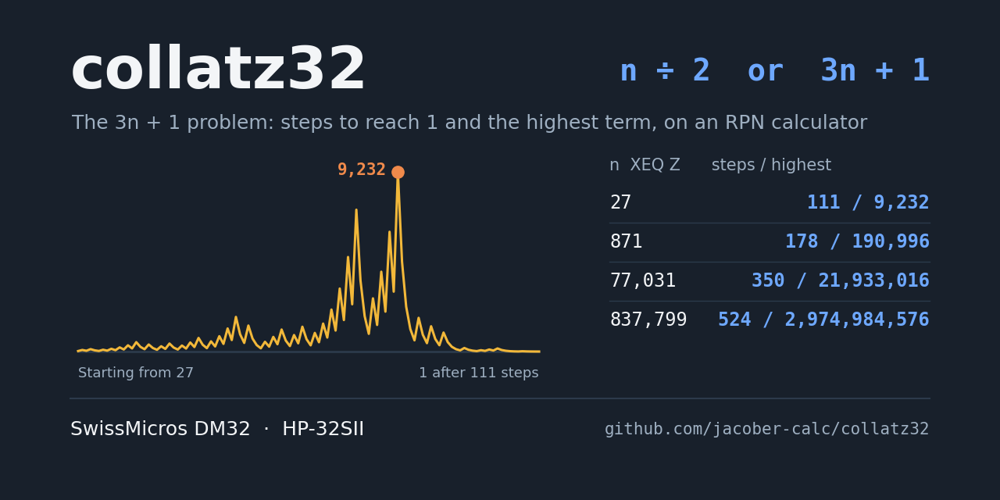
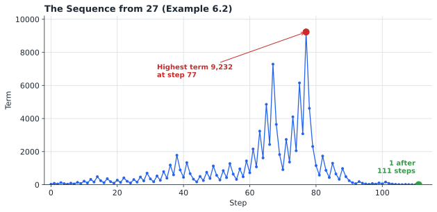
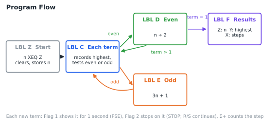
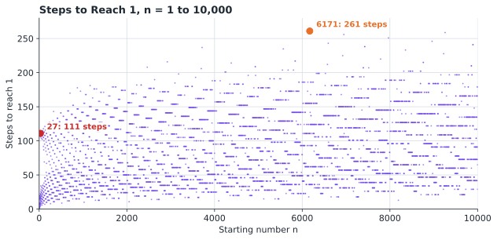
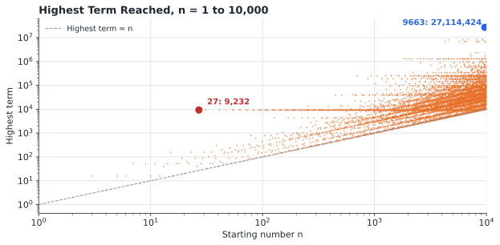

# collatz Statefile

## TABLE OF CONTENTS

1. [Introduction](#1-introduction)
2. [Theory of Operations](#2-theory-of-operations)
3. [Variable Definitions](#3-variable-definitions)
4. [Program Descriptions](#4-program-descriptions)
5. [Operating Instructions](#5-operating-instructions)
6. [Example Calculations](#6-example-calculations)
7. [Quick Reference](#7-quick-reference)
8. [Program Listing](#8-program-listing)

---

## 1. INTRODUCTION

This program runs the Collatz sequence, the 3n + 1 problem, on the SwissMicros DM32 calculator. From any positive whole number it applies the Collatz rule until the sequence reaches 1, then returns the number of steps taken and the highest term reached. Each term can be shown as it is calculated, or the sequence can be stepped through one term at a time.

### 1.1 Purpose

The program enables users to:

- Run the Collatz sequence from any positive whole number
- Count the steps needed to reach 1
- Find the highest term reached along the way
- Watch every term as it is calculated
- Step through the sequence one term at a time

### 1.2 System Requirements

SwissMicros DM32 calculator with RPN operating system. Program requires 59 program steps in 5 labels. Flags 1 and 2 control the display of terms (section 5.2). The step count is kept in the statistics registers.

Every instruction in the program is also available on the HP-32SII, so the program can be keyed into an HP-32SII as listed. The HP-32SII's 12-digit arithmetic limits the size of the terms it can handle (section 2.4).

### 1.3 Install and Download

Copy **COLLATZ.d32** to the `/STATE` folder of the DM32's internal USB disk, then load it from the calculator. Instructions are available [via the DM32 User Manual](https://technical.swissmicros.com/dm32/doc/dm32_user_manual.html#_saving_and_loading_a_state).

The Statefile is saved in FIX 6 display format. All results are whole numbers, so `[DISP] FIX 0` or ALL gives a cleaner display (section 5.1).

**The program clears all variables and the statistics registers** when it starts and again when it ends (lines Z02, Z03, F06, F07). Keep any values you need in another State.

---

## 2. THEORY OF OPERATIONS

### 2.1 The Collatz Rule

Start with any positive whole number n and apply one rule over and over:

```
If n is even:   next term = n ÷ 2
If n is odd:    next term = 3n + 1
```

From 6, for example, the sequence is 6, 3, 10, 5, 16, 8, 4, 2, 1: eight steps, with a highest term of 16. Once the sequence reaches 1 it would repeat 4, 2, 1 for ever, so the program stops there.

The **Collatz conjecture**, posed by Lothar Collatz in 1937, states that every starting number eventually reaches 1. It has been checked by computer for every starting number up to enormous values, but it has never been proved. Small starting numbers can take surprisingly long journeys: 27 takes 111 steps and climbs to 9,232 before it falls back to 1.



### 2.2 Program Flow



LBL Z clears the calculator's variables and statistics, stores the starting number, and falls into LBL C. For each term, LBL C:

1. Compares the term with the highest term so far (Y) and keeps the larger.
2. Tests whether the term is even: (term ÷ 2) has a fractional part of 0 for an even term and 0.5 for an odd one. The program doubles it to give 0 or 1, and `x=0?` chooses the branch.

LBL D halves an even term, and LBL E calculates 3n + 1 for an odd term. Both store the new term in A and count the step with `Σ+`, which adds 1 to the statistics count n. After halving, LBL D tests for 1 and goes to LBL F; otherwise both return to LBL C. The highest term includes the starting number itself.

LBL F recalls the starting number, the step count (`n`), and the highest term, and clears the variables and statistics. Lines F08 to F10 clear the T-register, leaving 0 in T.

### 2.3 Steps and Highest Terms

The number of steps jumps about from one starting number to the next, with no simple pattern. Some numbers stand out as record-holders, taking more steps or climbing higher than any smaller number.





### 2.4 Precision

The terms are whole numbers, and the program finds whether a term is even from the fractional part of term ÷ 2. For an odd term, term ÷ 2 needs one more digit than the term itself, for the 5 after the decimal point. The calculator holds this exactly as long as the term stays below:

| Calculator | Digits | Largest term handled correctly |
|------------|--------|--------------------------------|
| DM32 | 34 | 2 × 10³³ |
| HP-32SII | 12 | 2 × 10¹¹ |

Above this, an odd term ÷ 2 is rounded to a whole number, the term is treated as even, and the sequence goes wrong. On the DM32 the limit is far beyond any sequence a calculator can run in reasonable time; on the HP-32SII it can be reached. Example 6.6 climbs to 966,616,035,460, which is correct on the DM32 but beyond the HP-32SII's limit.

---

## 3. VARIABLE DEFINITIONS

| Variable | Description |
|----------|-------------|
| **Z** | Starting number n |
| **A** | Current term |
| **Y** | Highest term so far |
| **n** (statistics) | Number of steps, counted by Σ+ |

All variables and the statistics registers are cleared at the start and end of each run.

| Flag | Description |
|------|-------------|
| **1** | Set: show each new term for about 1 second (PSE) |
| **2** | Set: stop on each new term; press `[R/S]` to continue |

Flags 1 and 2 are not changed by the program; they stay set until cleared.

---

## 4. PROGRAM DESCRIPTIONS

### 4.1 LBL Z - Collatz Sequence

- **Input:** Starting number n in the X-register (a positive whole number)
- **Outputs (Stack display from top to bottom):**
  - T: 0
  - Z: Starting number n
  - Y: Highest term reached
  - X: Number of steps to reach 1

### 4.2 Internal Labels

- **LBL C:** Records the highest term and tests whether the term is even or odd
- **LBL D:** Even term: next term = n ÷ 2; tests for 1
- **LBL E:** Odd term: next term = 3n + 1
- **LBL F:** Places the results on the stack and clears the variables and statistics

---

## 5. OPERATING INSTRUCTIONS

### 5.1 Display Format

The results are whole numbers. For a clean display, press `[DISP]` and choose FIX 0 or ALL. Numbers longer than 12 digits are shown rounded; press and hold `[SHOW]` to see every digit.

### 5.2 Showing the Terms (Flags 1 and 2)

| Flag 1 | Flag 2 | Effect |
|--------|--------|--------|
| Clear | Clear | Runs to the end and shows only the results (fastest) |
| Set | Clear | Shows each new term for about 1 second |
| Clear | Set | Stops on each new term; press `[R/S]` for the next |
| Set | Set | Shows each term, then stops on it |

Set a flag with `[SF]` and clear it with `[CF]`, for example `[SF] [1]`. The 1 and 2 annunciators show which flags are set. While a sequence is stopped by Flag 2, `[R/S]` continues; clearing Flag 2 first lets it run on to the end.

### 5.3 Running a Sequence

```
1. Key in the starting number n
2. Press [XEQ] [Z]
```

To stop a long run, press `[R/S]`. To restart, key in the starting number again and press `[XEQ] [Z]`.

---

## 6. EXAMPLE CALCULATIONS

All results are whole numbers and are shown here without decimal places (FIX 0). In the saved FIX 6 format, 8 appears as 8.000000. Examples start with Flags 1 and 2 clear unless stated.

### 6.1 Watching a Short Sequence

**Problem:** Show the Collatz sequence from 6.

**Solution:**

| Keys | Display | Description |
|------|---------|-------------|
| `[SF] [1]` | | Show each term |
| `6 [XEQ] [Z]` | 3 | Each term is shown for about 1 second |
| | 10 | |
| | 5 | |
| | 16 | |
| | 8 | |
| | 4 | |
| | 2 | |
| | 1 | |
| | 8 | Number of steps |
| `[CF] [1]` | | Stop showing terms |

**Results (displayed on screen from top to bottom):**

| Register | Value | Meaning |
|----------|-------|---------|
| T | 0 | |
| Z | 6 | Starting number |
| Y | 16 | Highest term |
| X | 8 | Steps to reach 1 |

### 6.2 The Famous 27

**Problem:** How many steps does 27 take to reach 1, and how high does it climb?

**Solution:**
```
27 [XEQ] [Z]
```

**Results:**

| Register | Value | Meaning |
|----------|-------|---------|
| Z | 27 | Starting number |
| Y | 9,232 | Highest term, reached at step 77 |
| X | 111 | Steps to reach 1 |

### 6.3 Stepping Through a Sequence

**Problem:** Step through the sequence from 7 one term at a time.

**Solution:**

| Keys | Display | Description |
|------|---------|-------------|
| `[SF] [2]` | | Stop on each term |
| `7 [XEQ] [Z]` | 22 | 3 × 7 + 1 |
| `[R/S]` | 11 | 22 ÷ 2 |
| `[R/S]` | 34 | 3 × 11 + 1 |
| `[R/S]` | 17 | |
| `[R/S]` | 52 | Highest term |
| … | … | Continue with `[R/S]`: 26, 13, 40, 20, 10, 5, 16, 8, 4, 2 |
| `[R/S]` | 1 | Last term |
| `[R/S]` | 16 | Number of steps |
| `[CF] [2]` | | Stop stepping |

**Expected Results:** 16 steps; highest term 52 (Y).

### 6.4 Same Peak, Different Start

**Problem:** Run the sequence from 97.

**Solution:**
```
97 [XEQ] [Z]
```

**Expected Results:** 118 steps; highest term 9,232. The sequence from 97 joins the sequence from 27 on the way down, so both peak at 9,232.

### 6.5 Record Holders

**Problem:** Run the sequences from 871, 77,031, and 837,799. Each takes the most steps of any starting number below 1,000, 100,000, and 1,000,000 respectively.

**Solution:** Key in each number and press `[XEQ] [Z]`.

| Starting number (Z) | Highest term (Y) | Steps (X) |
|---------------------|------------------|-----------|
| 871 | 190,996 | 178 |
| 77,031 | 21,933,016 | 350 |
| 837,799 | 2,974,984,576 | 524 |

### 6.6 A Long Climb

**Problem:** Run the sequence from 63,728,127.

**Solution:**
```
63728127 [XEQ] [Z]
```

**Expected Results:** 949 steps; highest term 966,616,035,460. This sequence passes the HP-32SII's 12-digit limit (section 2.4); on the DM32 it is calculated exactly.

---

## 7. QUICK REFERENCE

### 7.1 Program Summary

| Label | Function | Input | Output |
|-------|----------|-------|--------|
| **Z** | Collatz sequence | X: starting number n | T: 0, Z: n, Y: highest term, X: steps |

| Flag | When set |
|------|----------|
| **1** | Show each term for 1 second |
| **2** | Stop on each term; `[R/S]` continues |

### 7.2 Important Notes

- Enter a positive whole number; the program does not check the input
- Starting from 1, the program runs one full cycle, 1 → 4 → 2 → 1, and returns 3 steps with a highest term of 4
- The highest term includes the starting number; for a power of 2 such as 16, the highest term is the starting number itself
- The program clears all variables and the statistics registers at the start and end of each run
- Flags 1 and 2 stay set until cleared with `[CF]`
- Showing every term with Flag 1 takes about 1 second per step; 27 takes nearly 2 minutes
- Terms are correct below 2 × 10³³ on the DM32 (2 × 10¹¹ on the HP-32SII)
- Press `[R/S]` to stop a long run

---

## 8. PROGRAM LISTING

The complete program listing is provided below. Program steps are shown in standard DM32 RPN format with label-relative line numbers, as displayed on the calculator. The DM32 does not generate checksums.

### LBL Z - Start

```
Z01  LBL Z   Collatz sequence. X: starting number n.
Z02  CLΣ     Clears statistics (step count).
Z03  CLVARS  Clears all variables.
Z04  STO Z   Starting number in Z.
```

### LBL C - Each Term

```
C01  LBL C   Each term. X: current term.
C02  STO A   Current term in A.
C03  RCL Y   Highest term so far.
C04  x<>y
C05  x≥y?    Term ≥ highest?
C06  STO Y   Then new highest, Y.
C07  2
C08  ÷       Term ÷ 2.
C09  FP      Fractional part:
C10  2
C11  ×       0 if even, 1 if odd.
C12  x=0?    Even?
C13  GTO D   Then halve.
C14  GTO E   Odd: 3n + 1.
```

### LBL D - Even Term

```
D01  LBL D   Even term.
D02  RCL A   Recalls term.
D03  2
D04  ÷       Next term = n ÷ 2.
D05  FS? 1   Flag 1 set?
D06  PSE     Then shows term for 1 second.
D07  FS? 2   Flag 2 set?
D08  STOP    Then stops; R/S continues.
D09  STO A   New term in A.
D10  Σ+      Counts one step.
D11  RCL A   Recalls term.
D12  1
D13  x<>y
D14  x≤y?    Term ≤ 1?
D15  GTO F   Then sequence done.
D16  GTO C   Next term.
```

### LBL E - Odd Term

```
E01  LBL E   Odd term.
E02  RCL A   Recalls term.
E03  3
E04  ×       3n.
E05  1
E06  +       Next term = 3n + 1.
E07  FS? 1   Flag 1 set?
E08  PSE     Then shows term for 1 second.
E09  FS? 2   Flag 2 set?
E10  STOP    Then stops; R/S continues.
E11  STO A   New term in A.
E12  Σ+      Counts one step.
E13  RCL A   Recalls term.
E14  GTO C   Next term.
```

### LBL F - Results

```
F01  LBL F   Results.
F02  RCL Z   Starting number.
F03  n       Number of steps.
F04  RCL Y   Highest term.
F05  x<>y    Order: Z: n, Y: highest, X: steps.
F06  CLVARS  Clears all variables.
F07  CLΣ     Clears statistics.
F08  R↑      Brings T to X,
F09  CLx     clears it,
F10  R↓      and returns it to T as 0.
F11  RTN     Done.
```

---

## Disclaimer

This program suite is provided as-is for educational and recreational use.

### By jacober-calc for SwissMicros DM32

> - [SwissMicros Website](https://www.swissmicros.com)
> - [DM32 product page](https://www.swissmicros.com/en/products/dm32)
> - [SwissMicros full products page](https://www.swissmicros.com/en/shop)
> - [DM32 Online User Manual](https://technical.swissmicros.com/dm32/doc/dm32_user_manual.html)
> - [SwissMicros Calculator Forum](https://forum.swissmicros.com/index.php)
